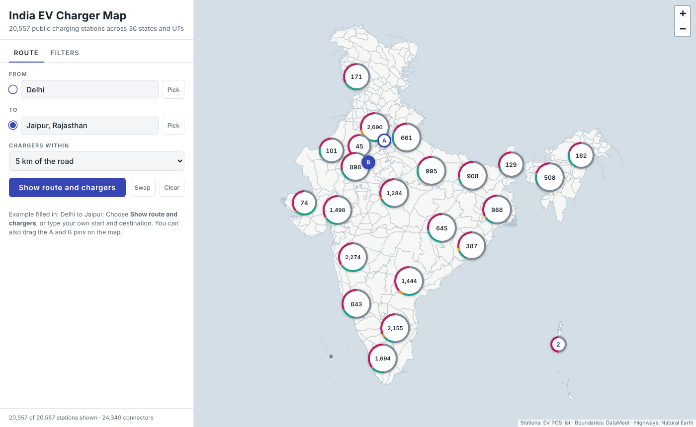
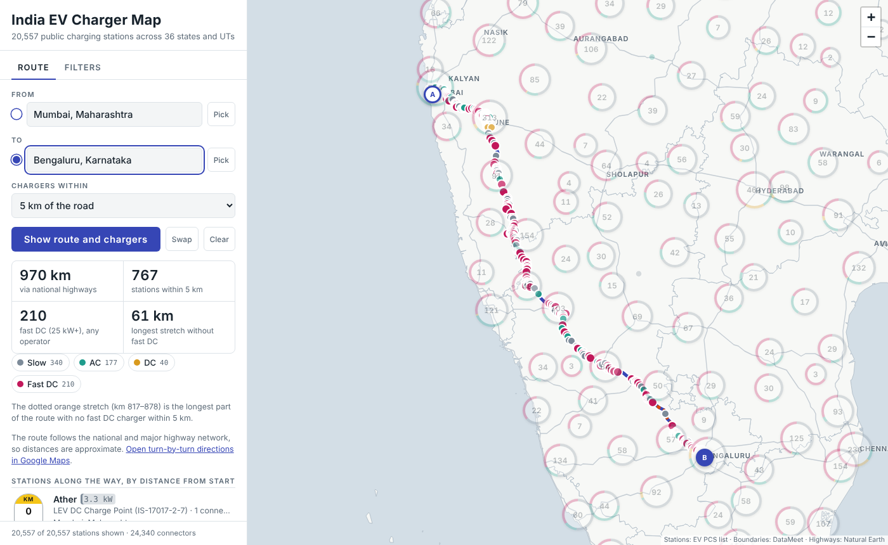
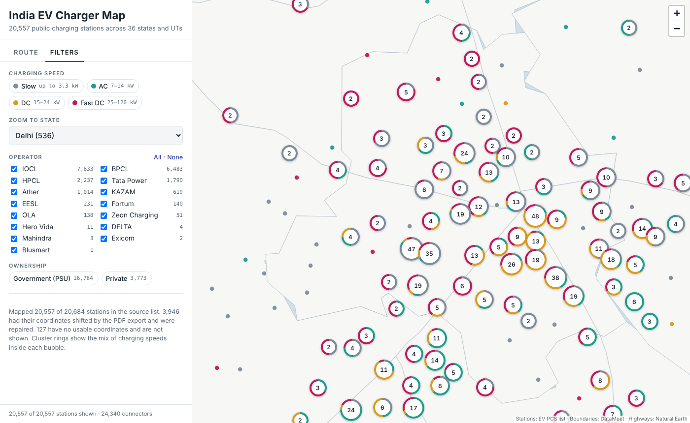
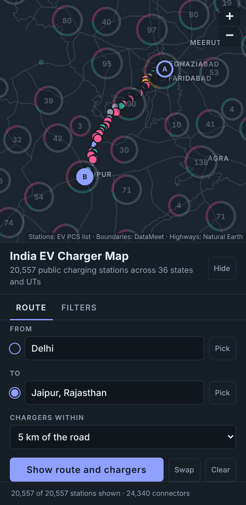

# India EV Charger Map

An interactive map of **20,557 public EV charging stations in India**, with a route planner that lists every charger along a journey between two places.

**[Open the live map →](https://anandparwatikar.github.io/india-ev-charger-map/)**



The map is a single HTML file. It needs no server, account or installation: open it in a browser and it works. All the station data, state outlines and the highway network are built into the file.

---

## Contents

- [What you can do](#what-you-can-do)
- [How to use it](#how-to-use-it)
- [Sharing the map](#sharing-the-map)
- [What's in the data](#whats-in-the-data)
- [How the data was cleaned](#how-the-data-was-cleaned)
- [How the route planner works](#how-the-route-planner-works)
- [Limitations](#limitations)
- [Repository layout](#repository-layout)
- [Rebuilding from the source data](#rebuilding-from-the-source-data)
- [Sources and credits](#sources-and-credits)

---

## What you can do

**See every station, grouped by zoom level.** When you zoom out, stations combine into numbered clusters. When you zoom in, the clusters split apart until you reach individual stations. Each cluster has a coloured ring showing the mix of charging speeds inside it, so you can see at a glance where fast charging is concentrated.

| Colour | Speed class | Charger rating | Typical use |
|---|---|---|---|
| Grey | Slow | up to 3.3 kW | 2- and 3-wheelers (LEV AC, Bharat AC) |
| Teal | AC | 7–14 kW | Cars, overnight or destination charging (Type 2 AC) |
| Amber | DC | 15–24 kW | Light DC charging (Bharat DC-001, LEV DC) |
| Magenta | Fast DC | 25–120 kW | Cars on highways (CCS, CCS2, CHAdeMO) |

**Inspect any station.** Click a dot to see its operator, connector type, power rating, number of connectors, government or private ownership, full address and a link to open the location in Google Maps.

**Filter.** Show only certain charging speeds, operators (IOCL, BPCL, HPCL, Tata Power, Ather and 10 others) or government/private ownership. You can also jump straight to any state.

**Plan a route.** Enter a start and a destination. The map draws the route along the national highway network and shows:

- the total distance
- how many chargers lie within 2, 5, 10 or 25 km of the road
- how many of them are fast DC (25 kW and above)
- the **longest stretch with no fast DC charger**, drawn as a dotted orange line on the map
- a list of every charger along the way, ordered by distance from the start and marked with an Indian highway-style km milestone



---

## How to use it

### Exploring

| To… | Do this |
|---|---|
| Zoom in or out | Scroll, pinch, or use the + / − buttons. Clicking a cluster zooms into it. |
| See station details | Click a coloured dot |
| Filter by speed, operator or ownership | Open the **Filters** tab and toggle the chips or checkboxes |
| Jump to a state | **Filters → Zoom to state** |

The footer always shows how many stations and connectors match your current filters.



### Planning a route

1. Open the **Route** tab.
2. In **From**, start typing a city, town or district and choose from the suggestions. You can also:
   - type coordinates such as `28.61, 77.21`, or
   - click **Pick** and then click a point on the map.
3. Do the same for **To**. The route is calculated as soon as both points are set.
4. Choose how far from the road to search for chargers (2, 5, 10 or 25 km).
5. Click any charger in the list to zoom to it on the map.

Other route controls:

- **Drag the A and B pins** on the map to adjust the route.
- **Swap** reverses the direction.
- **Clear** removes the route.
- The filters also apply to the route list. For example, turn off Slow and AC to see only DC chargers along the way.
- **Open turn-by-turn directions in Google Maps** sends the same start and destination to Google Maps for actual navigation.

The map adapts to phones, where the panel becomes a sheet at the bottom of the screen that you can hide. It also follows your device's light or dark setting.



---

## Sharing the map

| Method | Good for | How |
|---|---|---|
| **Live link** (GitHub Pages) | Anyone, on any device | Send the link at the top of this page |
| **The file itself** | Email, offline use, a shared drive | Send `index.html`. Recipients **download** it and double-click it to open it in a browser. |

**Why Google Drive shows the code:** Drive and similar storage services don't run web pages. They only display the file's text. The file has to be downloaded and then opened in a browser such as Chrome, Edge, Safari or Firefox. Phones generally can't open downloaded HTML files, so send phone users the live link.

The browser needs an internet connection the first time the file is opened, to load the map library (Leaflet) and fonts. All the data is already inside the file.

---

## What's in the data

The source is the public charging-station (PCS) list `EV_PCS_Data_29277`, which was published as a PDF and converted to Excel. It has 20,684 rows. After cleaning, 20,557 stations with 24,340 connectors are on the map.

**By operator**

| Operator | Stations | | Operator | Stations |
|---|---:|---|---|---:|
| IOCL | 7,833 | | EESL | 231 |
| BPCL | 6,483 | | Fortum | 140 |
| HPCL | 2,237 | | OLA | 138 |
| Tata Power | 1,790 | | Zeon Charging | 51 |
| Ather | 1,014 | | Hero Vida | 11 |
| KAZAM | 619 | | DELTA, Mahindra, Exicom, Blusmart | 10 |

The list is dominated by the three oil marketing companies (82% of stations are government/PSU). Several large private networks, such as Statiq, ChargeZone, Jio-bp pulse and Glida, **are not in the source list**, so the map does not show the whole Indian network.

**By charging speed:** 10,442 slow · 3,375 AC · 565 DC · 6,175 fast DC.

**By state:** Uttar Pradesh (2,280), Maharashtra (2,208), Karnataka (1,849), Tamil Nadu (1,743) and Rajasthan (1,477) have the most stations. All 36 states and union territories appear in the cleaned data. The full count is in [`data/processed/ev_stations_clean.csv`](data/processed/ev_stations_clean.csv).

### Data files

| File | What it is |
|---|---|
| `data/raw/EV_PCS_Data_29277.xlsx` | The source file, unchanged |
| `data/processed/ev_stations_clean.csv` | The 20,557 stations shown on the map, cleaned |
| `data/processed/ev_stations_unlocated.csv` | 127 stations without usable coordinates (kept for reference) |
| `data/processed/cleaning_report.json` | Counts from each cleaning step |

Columns in `ev_stations_clean.csv`:

| Column | Description |
|---|---|
| `operator` | Charge point operator (CPO) |
| `ownership` | `Government` or `Private` |
| `state`, `district`, `city`, `address` | Location as given in the source |
| `latitude`, `longitude` | WGS84 coordinates (repaired where needed) |
| `connector_type` | e.g. `CCS-II`, `Type-II AC`, `LEV AC Charge point` |
| `charger_kw`, `connector_kw` | Ratings in kW |
| `connectors` | Number of connectors |
| `speed_class` | `Slow`, `AC`, `DC` or `Fast DC` (see the table above) |
| `coord_status` | `original` or `repaired` |
| `state_source` | `source`, or `from_coordinates` where the state was blank |

---

## How the data was cleaned

The PDF-to-Excel conversion left three kinds of problems. [`scripts/03_clean_stations.py`](scripts/03_clean_stations.py) fixes them:

1. **Shifted columns (3,946 rows repaired).** In about one row in five, every value had moved one column to the right: the PIN code was in *Latitude*, the latitude in *Longitude*, and the longitude was stuck onto the front of the connector type (for example `92.724835 CCS-II`). The script looks at the numeric values in each row in order, takes the first pair that forms a valid coordinate inside India, and separates the real connector type from the leftover text.
2. **Blank states (271 rows filled).** Every Uttarakhand station (223) and a few dozen others had no state. The state was filled in by checking which state boundary the coordinates fall inside. Without this step Uttarakhand would be missing from the data entirely.
3. **Unusable locations (127 rows set aside).** 113 rows had no valid coordinate pair, and 14 had coordinates outside India. These are listed in `ev_stations_unlocated.csv` and are not shown on the map.

Operator names were also standardised (for example "Mahindra Automotive Manufacturers" became "Mahindra"). About 120 stations fall in a neighbouring state to the one recorded. Most are border towns, and they were left as recorded.

---

## How the route planner works

Online routing services can't be used from inside the published page, so the map carries its own road network:

- **Network:** Natural Earth 1:10m roads, clipped to India. This gives about **60,000 km** of national and major highways, held as a graph of 14,626 junctions. Line ends within 3 km of each other were joined so the network is connected.
- **Routing:** the start and destination snap to the nearest point on the highway network, and the shortest path between them is found with Dijkstra's algorithm, running in the browser.
- **Chargers along the route:** each station's perpendicular distance to the route line is measured. Stations within the chosen corridor are listed with their distance from the start, measured along the route.
- **Fast-charging gaps:** the longest distance between consecutive fast DC chargers, counting the start and end of the route, is reported and highlighted. This uses every operator, even ones you have filtered out of view.

Checked against real driving distances: Delhi → Jaipur comes out at 253 km (about 280 km by road) and Mumbai → Bengaluru at 970 km (about 985 km).

---

## Limitations

- **There's no street-level background map.** The map shows state outlines and highways only, so it works offline and inside restricted page hosts. The Google Maps link on each station and route covers street-level detail.
- **Routes follow major highways only.** Distances are approximate, and the first and last few kilometres are drawn as straight lines to the nearest highway. Use the Google Maps link for actual navigation.
- **The source list is incomplete.** Some major private networks are missing (see [What's in the data](#whats-in-the-data)), and the list reflects one point in time.
- **Station positions are as reported.** A few hundred source coordinates look approximate, for example several stations sharing one point.
- **State outlines** come from DataMeet and show Ladakh within Jammu & Kashmir, as in the pre-2019 boundaries.

---

## Repository layout

```
india-ev-charger-map/
├── index.html                  The map (open this). Built by scripts/04_build_map.py
├── build.sh                    Runs the whole pipeline
├── requirements.txt            Python packages for the pipeline
├── src/
│   └── template.html           Map source: layout, styles and JavaScript (data is injected at build)
├── scripts/
│   ├── common.py               Paths, speed classes, distance helper
│   ├── 01_download_sources.py  Fetches DataMeet and Natural Earth source files
│   ├── 02_prepare_geo.py       Simplifies state outlines, clips roads, builds the highway graph
│   ├── 03_clean_stations.py    Repairs coordinates, fills states, writes clean CSVs
│   └── 04_build_map.py         Bundles everything into index.html
├── data/
│   ├── raw/                    Source station list (unchanged)
│   ├── processed/              Cleaned stations, unlocated stations, cleaning report
│   └── geo/                    State outlines, India highways, highway graph
├── vendor/                     Leaflet and MarkerCluster stylesheets (inlined at build)
├── dist/
│   └── artifact.html           Same map without the HTML document wrapper (for embedding)
└── docs/screenshots/           Images used in this README
```

---

## Rebuilding from the source data

You need Python 3.10 or later.

```bash
pip install -r requirements.txt
./build.sh
```

`build.sh` runs the four scripts in order:

1. **Download** the DataMeet state boundaries and Natural Earth roads and places, about 70 MB in total, into `data/geo/_downloads/`. This folder is not committed.
2. **Prepare** the state outlines and the highway graph.
3. **Clean** the station list.
4. **Build** `index.html`.

**To update the stations,** replace `data/raw/EV_PCS_Data_29277.xlsx` with a newer export that has the same columns and run `./build.sh` again. If the file name changes, update `SOURCE_XLSX` in `scripts/common.py`.

**To change the look or behaviour** of the map, edit `src/template.html` and run `python3 scripts/04_build_map.py`.

---

## Sources and credits

| What | Source |
|---|---|
| Charging stations | Public charging station list `EV_PCS_Data_29277` (PDF, converted to Excel) |
| State boundaries | [DataMeet India maps](https://github.com/datameet/maps). See that repository for licence terms. |
| Highways and city names | [Natural Earth](https://www.naturalearthdata.com/) 1:10m roads and populated places (public domain) |
| Map library | [Leaflet](https://leafletjs.com/) 1.9.4 and [Leaflet.markercluster](https://github.com/Leaflet/Leaflet.markercluster) 1.5.3 (BSD-2-Clause and MIT) |
| Fonts | Barlow, Barlow Semi Condensed and IBM Plex Mono via Google Fonts (SIL Open Font License) |

Built by Anand Parwatikar.
